

  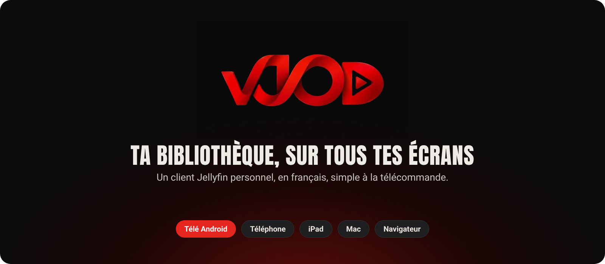

  
  
  

  <b>VJOD</b> est un client <a href="https://jellyfin.org">Jellyfin</a> personnel, tiré de <a href="https://github.com/Moonfin-Client/Moonfin-Core">Moonfin</a>. 
  Il sert à regarder les films et les séries de <b>sa propre bibliothèque</b>, sur la télé, le téléphone, l'iPad, le Mac et le navigateur.

## Télécharger VJOD

  <a href="https://github.com/ruizjonathan1988-web/Vjod-moon/releases/download/perso-latest/moonfin-tv.apk">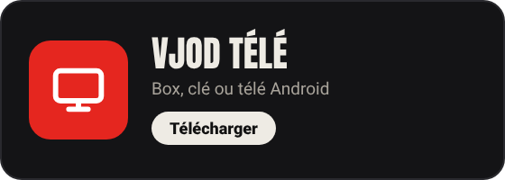</a>
  <a href="https://github.com/ruizjonathan1988-web/Vjod-moon/releases/download/perso-latest/moonfin-fold.apk">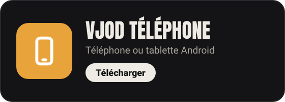</a>

  <a href="https://ruizjonathan1988-web.github.io/Vjod-moon/">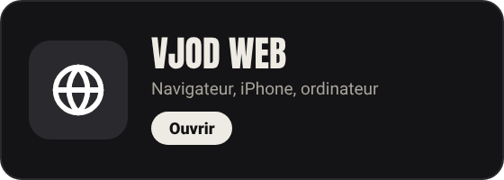</a>
  <a href="https://github.com/ruizjonathan1988-web/Vjod-moon/releases/download/ipad-latest/altstore.json">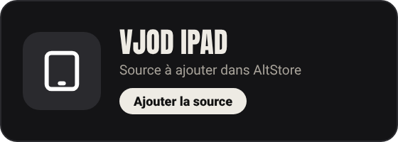</a>

  <a href="https://github.com/ruizjonathan1988-web/Vjod-moon/releases/download/mac-latest/vjod-mac.dmg">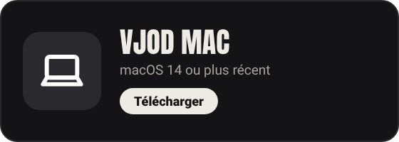</a>
  <a href="https://github.com/ruizjonathan1988-web/Vjod-moon/releases/download/perso-latest/moonfin-tv-arm32.apk">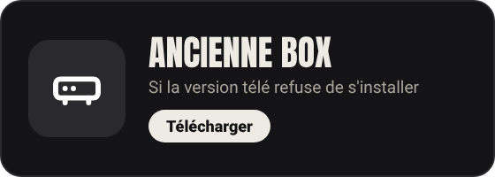</a>

> Les fichiers Android s'appellent `moonfin-….apk` : c'est bien VJOD. Ces noms restent pour que les mises à jour automatiques continuent de fonctionner.

### Installer en trois gestes

1. **Télé Android** : installe « Downloader » depuis le Play Store, tape l'adresse de la carte « VJOD Télé », puis *Installer*. **Téléphone** : ouvre le fichier téléchargé et autorise l'installation. **iPad** : ajoute la source dans AltStore. **Mac** : à la première ouverture, Réglages Système › Confidentialité et sécurité › *Ouvrir quand même*.
2. **Connecte-toi** avec l'adresse de ton serveur Jellyfin, ton identifiant et ton mot de passe.
3. **C'est tout** : VJOD se met ensuite à jour tout seul.

## Ce qu'il sait faire

  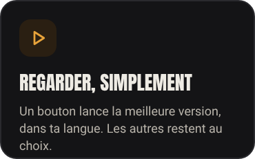
  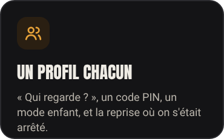
  

  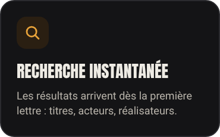
  
  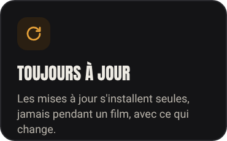

## Aura, le jeu qui va avec

  

  Aura transforme les soirées film en jeu de société : trois cartes défis chaque soir, une course contre Pop sur le plateau du mois, 
  et des films qu'on se propose entre amis. Branché sur VJOD, il pioche dans ta bibliothèque et ouvre les films dans VJOD.

  <a href="https://github.com/ruizjonathan1988-web/Aura-/releases/download/derniere/aura.apk">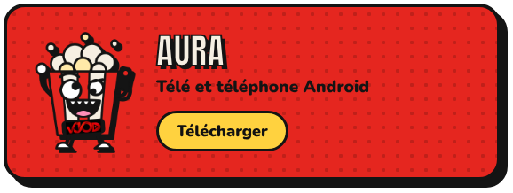</a>
  

## Ce qu'il faut

| | |
|---|---|
| **Serveur** | Ton propre serveur Jellyfin 10.8 ou plus récent, et un compte dessus |
| **Télé et téléphone** | Android 7.0 ou plus récent |
| **iPad** | iPadOS 18 ou plus récent, avec AltStore |
| **Mac** | macOS 14 (Sonoma) ou plus récent |
| **Navigateur** | Chrome, Safari, Edge ou Firefox récents |

## À savoir

- **Projet personnel, sans support.** Il n'est ni vendu ni proposé au public, et n'a aucun lien avec l'équipe de Jellyfin ou de Moonfin.
- **Aucun contenu, aucun service.** VJOD ne contient ni films ni séries, et ne donne accès à aucun catalogue : il affiche uniquement ce qui se trouve sur le serveur Jellyfin auquel on se connecte. Chacun reste responsable de ce qu'il met sur son propre serveur, et des droits qui vont avec.
- **Licence.** VJOD reprend le code de Moonfin et en garde la licence : voir [LICENSE](LICENSE). Aura a sa propre licence, tous droits réservés.

## Remerciements

VJOD repose sur [Moonfin](https://github.com/Moonfin-Client/Moonfin-Core) et sur [Jellyfin](https://jellyfin.org). Merci à leurs équipes.
